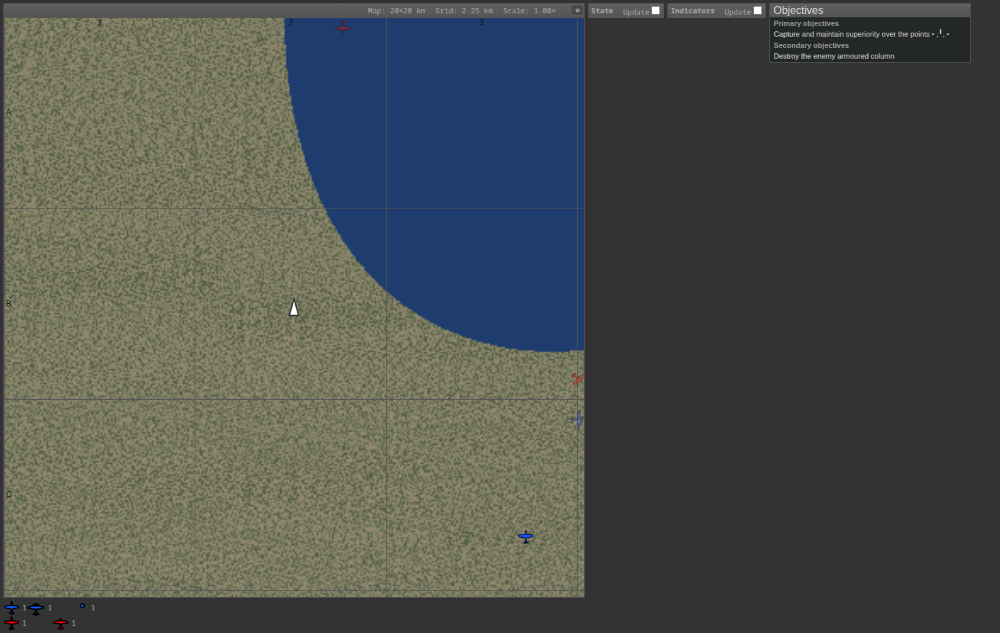
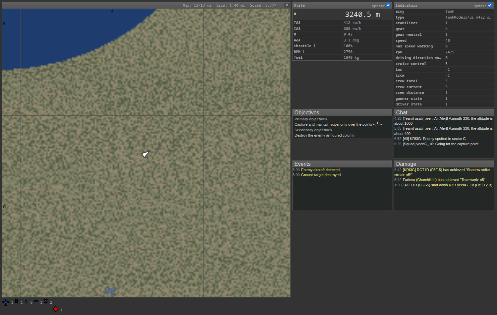

# WT map (userscript)

A Greasemonkey/Violentmonkey/Tampermonkey script that enhances the browser-based
map War Thunder serves on port 8111. It is a port of the [WT map Chrome
extension](https://github.com/slikts/wtmap) by Reinis Ivanovs (slikts), which
patches the same map code.



*Fighter (F-39), bomber (Ju 88) and attack aircraft (IL-2) are drawn with their
heading; contacts that are off the map are pinned to the edge at 35% opacity.
Below the map, a per-team count of every contact kind.*



*The side column: the map's own objectives, chat and HUD panels restyled to
match, plus State and Indicators as tables. Click a row to highlight it.*

## Install

1. Install a userscript manager (Tampermonkey, Violentmonkey or Greasemonkey).
2. Open `wtmap.user.js` and confirm the installation, or add it manually and
   paste the file.
3. Open <http://localhost:8111/> while War Thunder is running. To use the map
   from another device, allow `aces.exe` through the firewall and open
   `http://<game-pc-ip>:8111/`; the script matches any host on port 8111.

Settings live in `localStorage` on the map's own origin, so they follow the
origin you open the map on.

## What it does

* **Different icons per aircraft type** — fighters, bombers and attack aircraft
  get their own silhouette instead of a letter, drawn from the original
  extension's icon font, which is embedded in the script.
* **Icons point where the aircraft points**, taken from the contact's heading.
* **The map follows the player** (optional) and keeps the zoom level you chose,
  including across map changes and reloads.
* **Near real-time updates** — contacts are polled every 50 ms instead of the
  map's own 500 ms, which is also the frame rate.
* **A summary of every contact kind per team** under the map, using the same
  glyphs the map itself draws, so the count matches what you see.
* **Off-map contacts on the canvas edge**, dimmed, so you know what is over
  there without panning.
* **Distance readouts in the title bar**: `(E:6 > 1.55 km F:9) War Thunder Map`.
* **Ground units never obscure aircraft**: contacts are sorted so aircraft are
  drawn last.
* **Automatic map sizing** and a fixed panel layout, so the map takes the
  available space on any window size.
* **Optional State and Indicators panels**, rendered as tables with the values
  and units the game reports. Click a row to highlight it; the choice is
  remembered. Each panel has an inline *Update* toggle.
* **Chat and HUD message panels are hidden** by default (optional), and the
  mission objectives panel is restyled to fit the layout.
* **Map size, grid size and scale** in the map panel caption.
* An options dialog (⚙ in the map panel caption) replaces the extension's
  options page.

### Options

| Option | Default | Meaning |
| --- | --- | --- |
| Plane icon size | 25 | Icon size in pixels |
| Centre map on player | on | Follow the player |
| Units | km | km, mi, nmi, m or ft for the distance and size readouts |
| Map scale | 10 | Metres per map unit. The game uses a 0..2048 grid on 20 km maps and 0..4096 on 40 km maps, so 10 m per unit makes the readouts correct on both |
| Object poll rate | 50 ms | How often contacts are fetched; raise it to cut CPU and network use |
| Panel poll rate | 500 ms | How often the state, indicators, objectives and chat panels are fetched |
| Hide chat and HUD messages | on | Hide the chat, event and damage panels |
| Hide objectives | off | Hide the mission objectives panel |

`window.wtmap` is exposed in the page console (`wtmap.settings`, `wtmap.restart`,
`wtmap.layout`, …) for poking at things by hand.

## How it works

The extension could not patch the map directly: a Chrome content script only
sees the DOM, not the page's JavaScript. So it downloaded the map page, re-`eval`ed
its scripts inside an extension page and hid the originals.

A userscript injected into the page itself has no such restriction. This one
runs at `document-start` in the page context (`@grant none`), intercepts
`setInterval` so it can stop the map's own two timers, and then patches the
functions the map defines:

| Patched | Effect |
| --- | --- |
| `draw_map_object` | plane glyphs, heading, off-map clamping |
| `draw_player` | centres the view on the player |
| `update_object_positions` | sorts aircraft last, builds the summary and the title bar |
| `update_map_info` | map/grid/scale readouts, restores the stored zoom |
| `addWheelHandler` | remembers the zoom level |
| `updateSlow` | the map's polling is replaced by ours |

Panel drag/resize (`$.fn.draggable`/`resizable`/`sortable`) is disabled, since
the layout is automatic. Everything the page defines with `var`/`function` is
reached through `window.*`; the script declares no globals of its own.

## Differences from the extension

* The map is patched in place, so there is no separate extension page and no
  `base_url` option; the script polls the origin of the page it runs on.
* Chat, HUD messages and objectives are restyled into the side column instead
  of being hidden, and can be switched off in the options.
* The summary uses the map's full glyph mapping (`4`, `5`, `7`, `0`, `.`, …)
  instead of only Air defence and Structure, and leaves out respawn bases,
  which are spawn points rather than contacts.
* Friendly green contacts were counted as enemies by the extension's
  `r > b` rule; the rule now allows for the second friendly team's colour.
* Objectives and messages show empty when the map has nothing to report, and
  the state/indicator values are formatted (`412 km/h`, not `412.000000`).
* Numbers in the options dialog are clamped to sane ranges.
* A bug inherited from the extension is fixed: the contact sort returned a
  boolean from its comparator, which `Array.prototype.sort` ignores, so
  aircraft were not in fact drawn last.

## Development

```sh
npm install                # puppeteer-core, for the tests only
npm run capture            # copy the map page and live data off a running game
npm test                   # start the fixture and run the suite (headless)
```

`npm test` needs the map page in `test/asset/`. It is not committed, since it is
the game's own code: run `npm run capture` once with War Thunder up. Anything
captured is preferred over the stand-ins, so with a capture the suite exercises
the genuine page scripts.

Useful variations:

```sh
npm test -- --headed              # watch it run
npm test -- --keep                # leave the fixture server running on :8112
npm test -- --port 8123           # use another port
node test/run.js --url http://localhost:8111/    # test a running game instead
npm run fixture                   # just serve the fixture map on :8112
```

The suite drives a real browser and checks the DOM, the request counts per
endpoint, and the canvas pixels: that aircraft are drawn with the plane glyphs
at the right angle and position, that off-map contacts are clamped to the edge
(compared by diffing a frame with and without them), that the map recentres on
the player, and that settings survive a reload. Screenshots land in
`test/output/`.

### Layout

```
wtmap.user.js            the userscript, the whole deliverable
test/server.py           fixture map server (serves the map page and its endpoints)
test/capture.py          pulls the map page and live data off a running game
test/demo_data.py        synthetic contacts covering every icon kind and both teams
test/run.js              the test suite and runner
test/static/shims/       stand-ins for the map's third party scripts
test/static/loc|css/     localisation and an empty stylesheet the page links to
test/asset/              captured page, fonts and data (git ignored)
test/output/             screenshots (git ignored)
```

## Credits

A userscript port of the [WT map Chrome extension](https://github.com/slikts/wtmap)
by Reinis Ivanovs (slikts), MIT licensed. The plane glyphs are its icon font,
embedded in `wtmap.user.js`, and the panel layout and CSS are adapted from the
extension's own stylesheet.

War Thunder is a trademark of Gaijin Entertainment; this project is not
affiliated with or endorsed by them. The map page, its icons font and the
endpoint payloads the test fixture serves are the game's own files and are not
distributed here.