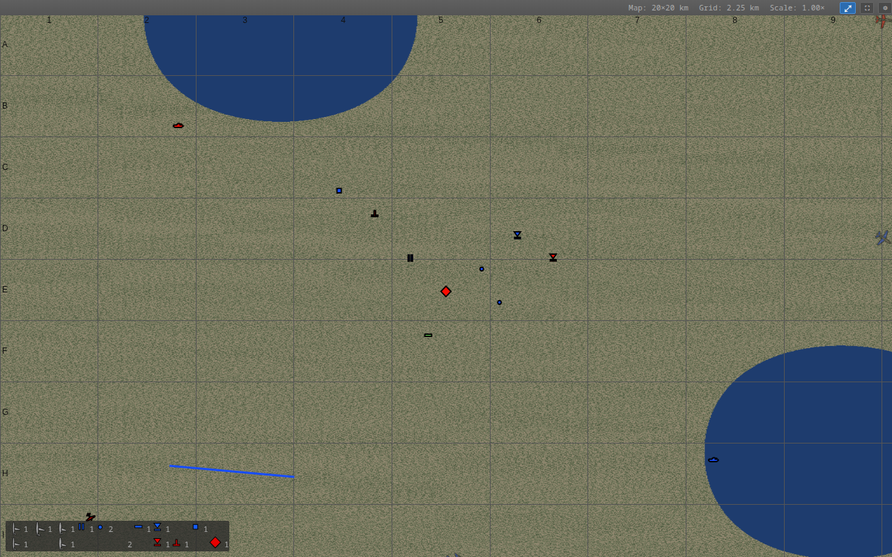

# WT map (userscript)

A Greasemonkey/Violentmonkey/Tampermonkey script that enhances the browser-based
map War Thunder serves on port 8111.

It is a single self-contained file with no dependencies: the aircraft
silhouettes are vector polygons defined in the script, the only font it uses is
the map's own icon font (which the page already loads), and nothing belonging to
anyone else is bundled or redistributed.


*Fighters, bombers and attack aircraft are drawn with their heading; contacts
that are off the map are pinned to the edge at 35% opacity. Below the map, a
per-team count of every contact kind.*


*The side column: the map's own objectives, chat and HUD panels restyled to
match, plus State and Indicators as tables. Click a row to highlight it.*

## Install

1. Install a userscript manager (Tampermonkey, Violentmonkey or Greasemonkey).
2. Open `wtmap.user.js` and confirm the installation, or add it manually and
   paste the file.
3. Open <http://localhost:8111/> while War Thunder is running. To use the map
   from another device, allow `aces.exe` through the firewall and open
   `http://<game-pc-ip>:8111/`; the script matches any host on port 8111.

Settings live in `localStorage` on the map's own origin, so they follow the
origin you open the map on.

## What it does

* **Different icons per aircraft type** — fighters, bombers and attack aircraft
  get their own silhouette instead of a letter. The outlines are drawn here as
  polygons and filled onto the canvas, so they scale cleanly and there is no
  font to load.
* **Icons point where the aircraft points**, taken from the contact's heading.
* **The map follows the player** (optional) and keeps the zoom level you chose,
  including across map changes and reloads.
* **Near real-time updates** — contacts are polled every 50 ms instead of the
  map's own 500 ms, which is also the frame rate.
* **A summary of every contact kind per team** under the map, using the same
  glyphs the map itself draws, so the count matches what you see.
* **Off-map contacts on the canvas edge**, dimmed, so you know what is over
  there without panning.
* **Distance readouts in the title bar**: `(E:6 > 1.55 km F:9) War Thunder Map`.
* **Ground units never obscure aircraft**: contacts are sorted so aircraft are
  drawn last.
* **Automatic map sizing** and a fixed panel layout, so the map takes the
  available space on any window size.
* **Fullscreen** with the panels kept beside the map, floating over it, or
  hidden, whichever you prefer.
* **Full window mode**, F11 style: the map fills the whole browser window at any
  aspect ratio and follows it while you resize or maximise.
* **Optional State and Indicators panels**, rendered as tables with the values
  and units the game reports. Click a row to highlight it; the choice is
  remembered. Each panel has an inline *Update* toggle.
* **Chat and HUD message panels are hidden** by default (optional), and the
  mission objectives panel is restyled to fit the layout.
* **Map size, grid size and scale** in the map panel caption.
* An options dialog (⚙ in the map panel caption) replaces the extension's
  options page.

### Options

| Option | Default | Meaning |
| --- | --- | --- |
| Plane icon size | 25 | Icon size in pixels |
| Centre map on player | on | Follow the player |
| Units | km | km, mi, nmi, m or ft for the distance and size readouts |
| Map scale | 10 | Metres per map unit. The game uses a 0..2048 grid on 20 km maps and 0..4096 on 40 km maps, so 10 m per unit makes the readouts correct on both |
| Object poll rate | 50 ms | How often contacts are fetched; raise it to cut CPU and network use |
| Panel poll rate | 500 ms | How often the state, indicators, objectives and chat panels are fetched |
| Hide chat and HUD messages | on | Hide the chat, event and damage panels |
| Hide objectives | off | Hide the mission objectives panel |
| Full window mode | off | The map fills the whole browser window, as if you pressed F11 |
| Fullscreen panels | Beside the map | What happens to the side panels while fullscreen: beside the map, over the map, or hidden |

### Fullscreen, full window and shortcuts

Three buttons sit at the right of the map panel caption: **⤢** full window mode,
**⛶** fullscreen and **⚙** options.

| Key | Action |
| --- | --- |
| `F` | Toggle fullscreen |
| `M` | Toggle full window mode |
| `Escape` | Leave full window mode (or fullscreen, which the browser handles) |

Fullscreen uses the browser's own Fullscreen API, so the browser's usual rules
apply: it needs a user gesture, `Escape` leaves it, and it ends on its own when
the tab is switched. The layout is recomputed whenever the state changes, so it
also reacts to entering fullscreen with the browser's own button or a video
element.

In **full window mode** the canvas is resized to the exact dimensions of the
browser window, so on a wide screen the map is stretched to the window's aspect
ratio rather than staying square. It re-lays out on every resize, so maximising
the window or pressing the browser's `F11` is enough to make the map fill the
screen; full window mode itself just also hides the panels and drops the page
margins. `Escape` or `M` brings the layout back.



*Full window mode, 1280x800: the map fills the window and only the caption bar
with the readouts and the three buttons is left.*

`window.wtmap` is exposed in the page console (`wtmap.settings`, `wtmap.mode()`,
`wtmap.fullscreen()`, `wtmap.full_window()`, `wtmap.restart`, `wtmap.layout`, …)
for poking at things by hand.

## How it works

The script runs at `document-start` in the page's own JavaScript environment
(`@grant none`), which is what lets it reach and patch the map's functions
directly. It intercepts `setInterval` so it can stop the map's own two timers,
and then patches what the map defines:

| Patched | Effect |
| --- | --- |
| `draw_map_object` | plane glyphs, heading, off-map clamping |
| `draw_player` | centres the view on the player |
| `update_object_positions` | sorts aircraft last, builds the summary and the title bar |
| `update_map_info` | map/grid/scale readouts, restores the stored zoom |
| `addWheelHandler` | remembers the zoom level |
| `updateSlow` | the map's polling is replaced by ours |

Panel drag/resize (`$.fn.draggable`/`resizable`/`sortable`) is disabled, since
the layout is automatic. Everything the page defines with `var`/`function` is
reached through `window.*`; the script declares no globals of its own.

## What it depends on

Nothing but the map page itself, and nothing that is redistributed here:

| Asset | Where it comes from |
| --- | --- |
| Aircraft silhouettes | Polygons in `wtmap.user.js`, drawn to canvas and to inline SVG |
| Ground unit and structure glyphs in the summary | The map's own icon font, referenced by family name; the page loads it from its own server |
| Layout and stylesheet | Written for this script |
| Map page, map image, endpoint payloads | The game's own files, only ever read at runtime, never copied into this repo |

War Thunder is a trademark of Gaijin Entertainment; this project is not
affiliated with or endorsed by them, and it patches only the page in your own
browser at your own request.

A browser extension by Reinis Ivanovs (slikts) existed first for the same map
and is where the idea of aircraft icons on it comes from. Nothing from it is
used here.

## Notes on behaviour

* Chat, HUD messages and objectives are restyled into the side column rather
  than hidden, and can be switched off in the options.
* The summary uses the map's full glyph mapping (`4`, `5`, `7`, `0`, `.`, …)
  and leaves out respawn bases, which are spawn points rather than contacts: a
  large ground battle sends over a hundred of them and they would swamp the
  summary.
* Respawn bases are still drawn on the map, as the game intends; only the
  counts ignore them.
* Friendly green contacts count as friendly. Judging by `r > b` alone, as a
  naive rule does, files them as enemies.
* Objectives and messages show empty when the map has nothing to report, and
  the state/indicator values are formatted (`412 km/h`, not `412.000000`).
* Numbers in the options dialog are clamped to sane ranges.
* The map's grid is not always at the origin: some maps span `1024..3072`
  rather than `0..2048`, so sizes are always derived from the difference.
* The aircraft artwork is drawn, not typeset: it scales to any icon size and
  needs no font to be loaded before the first frame.

## Development

```sh
npm install                # puppeteer-core, for the tests only
npm run capture            # copy the map page and live data off a running game
npm test                   # start the fixture and run the suite (headless)
```

`npm test` needs the map page in `test/asset/`. It is not committed, since it is
the game's own code: run `npm run capture` once with War Thunder up. Anything
captured is preferred over the stand-ins, so with a capture the suite exercises
the genuine page scripts.

Useful variations:

```sh
npm test -- --headed              # watch it run
npm test -- --keep                # leave the fixture server running on :8112
npm test -- --port 8123           # use another port
node test/run.js --url http://localhost:8111/    # test a running game instead
npm run fixture                   # just serve the fixture map on :8112
```

The suite drives a real browser and checks the DOM, the request counts per
endpoint, and the canvas pixels: that aircraft are drawn with the plane glyphs
at the right angle and position, that off-map contacts are clamped to the edge
(compared by diffing a frame with and without them), that the map recentres on
the player, that full window mode fills the window and follows a resize, that
each fullscreen panel mode lays out as expected, and that settings survive a
reload. Screenshots land in `test/output/`.

### Layout

```
wtmap.user.js            the userscript, the whole deliverable
test/server.py           fixture map server (serves the map page and its endpoints)
test/capture.py          pulls the map page and live data off a running game
test/demo_data.py        synthetic contacts covering every icon kind and both teams
test/run.js              the test suite and runner
test/static/shims/       stand-ins for the map's third party scripts
test/static/loc|css/     localisation and an empty stylesheet the page links to
test/asset/              captured page, fonts and data (git ignored)
test/output/             screenshots (git ignored)
```

## Credits

Everything here is original work: the aircraft silhouettes, the layout, the
stylesheet and the patching. No code or artwork from anyone else is bundled or
redistributed, and no licence file is attached.

War Thunder is a trademark of Gaijin Entertainment; this project is not
affiliated with or endorsed by them. The map page, its icons font and the
endpoint payloads the test fixture serves are the game's own files: they are read
at runtime from your own copy of the game, and are never committed to this
repository.

The idea of putting aircraft icons on the map came from a browser extension by
Reinis Ivanovs (slikts) that did the same thing for the same page.
